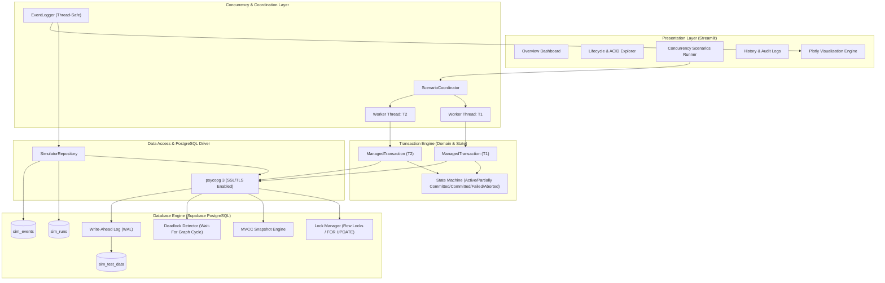
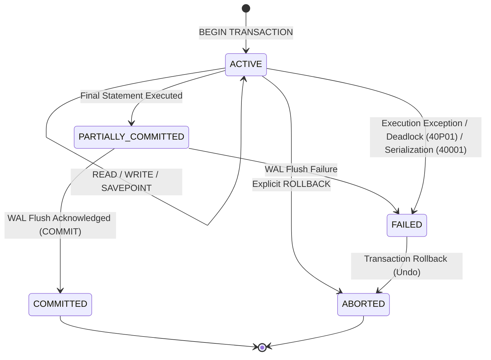
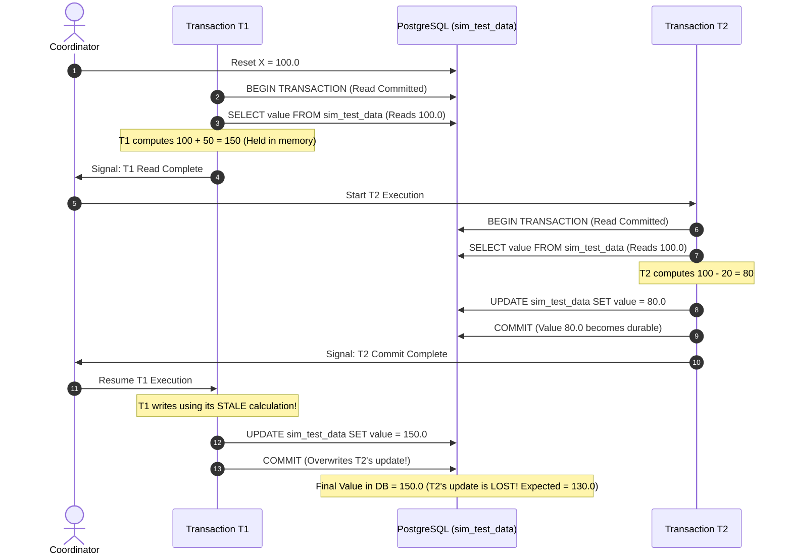
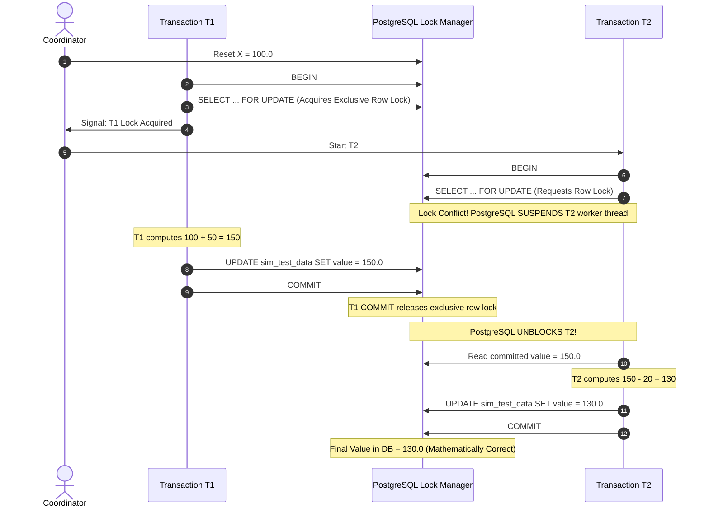
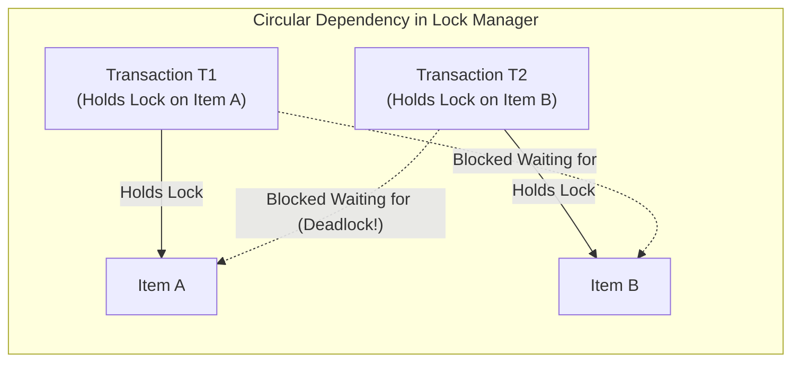

# Architecture & Transaction Execution Diagrams

This document contains architectural diagrams and execution flow models for the **Transaction Management and Concurrency Control Simulator**.

---

## 1. System Architecture Diagram

---

## 2. Transaction Lifecycle State Transitions

---

## 3. Concurrency Scenario A: Lost Update Anomaly Flow

---

## 4. Concurrency Scenario B: Pessimistic Locking Flow (`SELECT ... FOR UPDATE`)

---

## 5. Concurrency Scenario F: Deadlock Wait-For Graph Cycle

